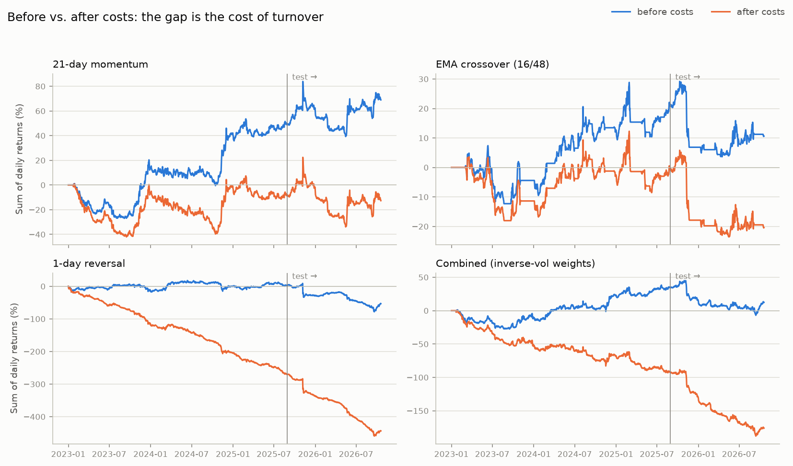

# Does momentum or reversal make money in crypto after trading costs?

A research project from the Wall Street Quants course. I tested cross-sectional momentum and reversal on 15 liquid coins traded on Binance, using daily bars from 1 January 2023 to 19 October 2026. The full write-up, with every number computed live, is in [`notebooks/performance_summary.ipynb`](notebooks/performance_summary.ipynb).

## Short answer

No. At the course's assumed cost of 20 bps per trade, every strategy in the train/test comparison below loses money in both periods.

The more useful finding is why. Before costs, all four main strategies are flat or positive on the training data. After costs, none is. **Costs, not the direction of the signal, decide every result here.** The clearest case is 1-day reversal. Its net Sharpe of −4 looked like a strong (if backwards) signal, but before costs its training Sharpe is +0.04. It trades 1.4 times its book every day, and at 20 bps that costs about 100% a year.

21-day momentum is the one signal I'd keep working on. It's positive before costs in both periods, and its breakeven cost holds steady at 16 to 17 bps per unit traded. That's just under the 20 bps it pays.

## Before vs. after costs

| Strategy | Sharpe before costs | Sharpe after 20 bps | Breakeven cost (bps) | Turnover per day |
|---|---|---|---|---|
| 21-day momentum | +0.78 / +0.47 | −0.13 / −0.11 | 17 / 16 | 0.30 / 0.29 |
| EMA crossover (16/48) | +0.48 / −0.55 | −0.01 / −1.03 | 20 / −23 | 0.11 / 0.11 |
| 1-day reversal | +0.04 / −1.26 | −3.99 / −3.90 | 0 / −10 | 1.40 / 1.42 |
| 1-day momentum (reversal flipped) | −0.04 / +1.26 | −4.09 / −1.38 | 0 / 10 | 1.40 / 1.42 |
| Combined (inverse-vol weights) | +0.59 / −0.87 | −1.55 / −3.24 | 6 / −7 | 0.65 / 0.74 |

Each cell is training / test. Breakeven cost is the cost per unit traded at which a strategy would exactly break even, so a strategy with a breakeven below 20 bps loses money on market orders, and one below 7 bps loses even on limit orders. Turnover is the fraction of the book traded each day.



## How it was tested

The first 70% of the sample (up to 29 August 2025) is the training period and the last 30% is the test period. The momentum lookback, the EMA pair and the way the signals are combined were all chosen on training data, and the test period was only used to judge those choices. Portfolios are dollar-neutral long-short. Positions are set at each daily close from data up to that close and held to the next one. Costs follow the course brief: 7 bps commission plus 13 bps slippage on market orders, 7 bps on limit orders.

A 5-fold walk-forward search (`optimize.py`) re-picks the parameters fold by fold. Its best out-of-sample result, EMA crossover at a net Sharpe of +0.20 (alpha t-stat 0.27), can't be told apart from zero.

## The 1-day result, checked before believing it

My course mentor suggested flipping 1-day reversal into 1-day momentum, and it was the obvious thing to try. It doesn't help. Turnover and cost are the same in either direction, and in training neither direction has an edge. The flipped trade does make money before costs in the test period, but:

- 57% of that profit came from one coin on one day: FIL/USDT on 7 November 2025, the day after a 35% jump, when the strategy held 42% of its book in FIL. The prices are real (OKX and Kraken show the same move).
- Taking out the 5 best test days, about 1% of them, drops its gross Sharpe from +1.26 to −0.10. Trading one day late drops it to +0.05.
- It isn't a bull-market effect. In training it did worse on up-trend days (−0.55) than on down-trend days (+0.19).
- Volume doesn't rescue it. Momentum among high-volume coins minus momentum among low-volume coins has a t-stat of −2.1 in training and +1.7 in test, so the sign flips between periods.

The walk-forward optimiser points the same way from the other side. It almost always picked the lowest-turnover option on each grid, which is what a search does when the cheapest signal to trade wins.

## Limitations

- **The universe was picked with hindsight.** I chose these 15 coins in 2026, and SOL alone went from $9.99 on the first day of the sample to $105 on the last. Coins delisted during the sample, like WAVES, MULTI and ANT, can't be in it at all.
- **The evidence is thin.** None of the positive results before costs has a t-stat of 2 or more. At a Sharpe of 0.78 you'd need about 6½ years of data to get there, and this sample is under 4.
- **The test period isn't fresh any more.** It has informed several decisions now, so the next test has to be judged on data the project hasn't seen.
- **Costs are flat.** BTC and FIL pay the same 20 bps, which flatters small coins and penalises big ones. Limit orders are an optimistic way out for momentum, too, because a resting order mostly fills when the price comes back against you.
- One exchange, daily bars only.

## Next steps

1. Rebuild the universe point-in-time: each month, the top 50 or so USDT pairs by trailing 30-day dollar volume, including coins that were later delisted. Binance's public archive at data.binance.vision still has their price history.
2. Test one cost-aware version of 21-day momentum, written down before it's run. It would move only part of the way towards its target weights each day (Gârleanu and Pedersen, 2013), with positions scaled by rank and volatility. With breakeven at 16 to 17 bps against 20 bps of cost, trading less is the one economically sensible route to a positive result. It gets judged once, on coins and dates the project hasn't touched.

The results also need confidence intervals on every Sharpe and a deflated Sharpe ratio for the best one, because dozens of variants have been tried across the project.

## Reproduce

```bash
uv sync                                    # Python 3.12+, managed with uv
uv run python main.py                      # train/test split, parameter selection, report
uv run python short_horizon_study.py       # the 1-day follow-up experiments
uv run python optimize.py                  # 5-fold walk-forward search
uv run --group notebooks jupyter nbconvert --to notebook --execute --inplace notebooks/performance_summary.ipynb
uv run pytest
```

The first run downloads daily data from Binance (no API key needed) and caches it in `data/raw/`. The sample end is pinned in `main.py`, so every run sees the same data, and re-running the notebook also redraws the chart above.

Under the hood: a ccxt data pipeline with validation and a parquet cache, a backtester that lags positions and charges costs on turnover, three ways to combine signals, performance and alpha statistics, and an audit log of every run, all in `src/quant_project/` with 127 tests at 99% coverage.
